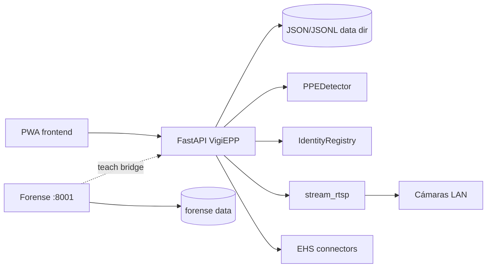

# 01 — Inventario del sistema

**Fecha evidencia:** 2026-10-22 (America/Santiago) · **Build:** v68

## 1. Arquitectura y patrón

| Aspecto | Evidencia |
|---------|-----------|
| Patrón | **Monolito edge** FastAPI sirve API REST + estáticos PWA (`backend/app/main.py`) |
| Despliegue | On-prem / LAN por faena; opcional demo cloud (Render/Railway) sin RTSP LAN |
| Producto | VigiEPP (EPP + identidad) + **Forense** aislado en `:8001` |
| Multitenancy | **No SaaS** — multi-sitio local (`sites.json`) por datos en disco, no aislamiento cloud |

## 2. Stack

| Capa | Tecnología | Versión / nota |
|------|------------|----------------|
| Backend | Python 3.12, FastAPI, Uvicorn | `backend/requirements.txt` |
| IA | Ultralytics YOLO, OpenCV, ONNX SFace/YuNet | inferencia lazy / `VIGIEPP_COMBINED_INFERENCE` |
| Frontend | HTML/CSS/JS modular (sin bundler), ESLint | `frontend/assets/modules/*` |
| Forense | App FastAPI separada | `forense/` |
| CI | GitHub Actions | `.github/workflows/ci.yml` |
| Contenedores | Docker Compose | `docker-compose.yml`, `Dockerfile` |

## 3. Autenticación y autorización

- PIN admin / operador + sesión token (`sessions.json`) o cookie (`backend/app/auth.py`)
- API key estática opcional (`VIGIEPP_API_KEY`) → rol admin
- OIDC opcional (Microsoft/Azure) — endpoints `/api/auth/oidc/*`
- RBAC granular operador vs admin (`backend/app/rbac.py`, tests `test_rbac.py`, `test_operator_access.py`)

## 4. Persistencia (no SQL)

Archivos JSON/JSONL bajo `VIGIEPP_DATA_DIR`:

- `workers.json`, `faces/`, `cameras.json`, `zones.json`, `sites.json`, `privacy.json`
- `scan_events.jsonl`, `audit.jsonl`, `sessions.json`, `ehs_*.json`
- Cifrado Fernet para secretos NVR/EHS con `VIGIEPP_SECRETS_KEY` (`secret_box.py`, `ehs_connectors.py`)

## 5. API — 81 paths / 93 operaciones

Inventario generado vía OpenAPI (`app.openapi()`) en auditoría:

- Core: `/api/health`, `/metrics`
- Auth, detect, identity, teach, zones, actions, reports, notifications
- RTSP, cameras, NVR, watchlist, surveillance/mass
- Privacy, EHS, audit, sites, evidence/scans

## 6. Integraciones externas

| Integración | Uso | Config |
|-------------|-----|--------|
| NVR RTSP (Dahua/Hikvision) | Video LAN | `nvr.py`, `rtsp_security.py` |
| WhatsApp Cloud | Notificaciones | `whatsapp_cloud.py` |
| EHS webhooks / SafetyCloud | Incidentes | `ehs_connectors.py` |
| OIDC | SSO enterprise | `oidc.py` |
| Redis (opcional) | Estado OIDC multi-worker | env |
| OSHA DOL API (Forense) | Fuentes | `VIGIEPP_FORENSE_DOL_API_KEY` |
| Google Fonts | Tipografía UI | `index.html` (CSP v68) |

**No hay** pasarelas de pago ni suscripciones SaaS en el código auditado.

## 7. Variables de entorno críticas

Referencia: `.env.example`, `docs/RUNBOOK_DEPLOY_EDGE.md`

- Auth: `VIGIEPP_AUTH`, PINs, `VIGIEPP_API_KEY`, `VIGIEPP_COOKIE_SECURE`
- Edge: `VIGIEPP_DATA_DIR`, `VIGIEPP_SECRETS_KEY`, `VIGIEPP_ALLOW_LAN`, `VIGIEPP_RTSP_ALLOW`
- Cloud hardening: `RENDER`, startup checks bloquean PINs default

## 8. Mapa de dependencias (simplificado)

## 9. Deuda / componentes incompletos (evidencia código)

- Producto explícitamente **no** construye billing, sync cloud-edge pilar, RBAC multi-tenant cloud (`AGENTS.md`)
- `tenants.py` = multi-**sitio** faena, no multi-cliente SaaS
- OTEL: stub / flags (`otel_trace.py`)
- Sin ORM ni migraciones SQL

## 10. Controles verificados en esta fase

~**72 %** del inventario (código + OpenAPI + CI + ejecución local); build Docker productivo **no** reconstruido en esta corrida (ver 04 y 11).
